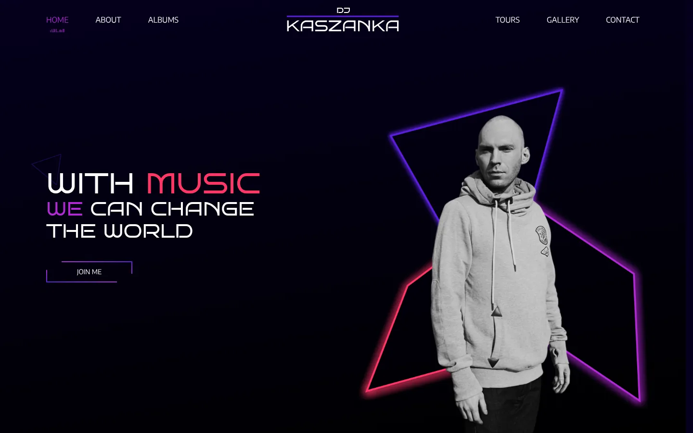
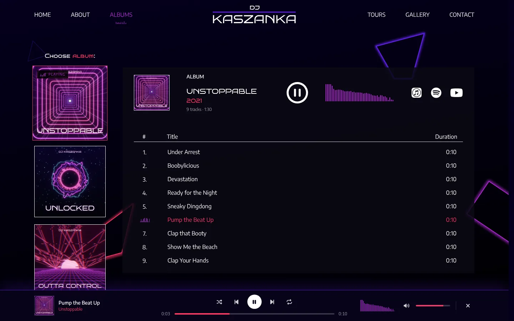
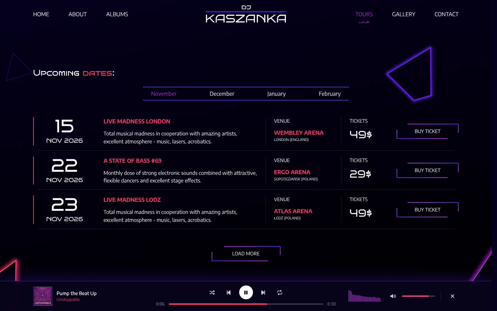
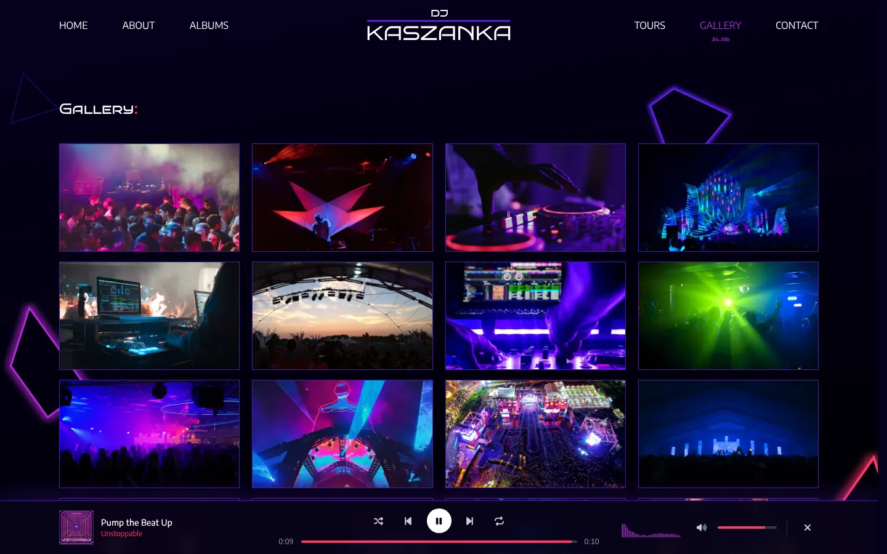
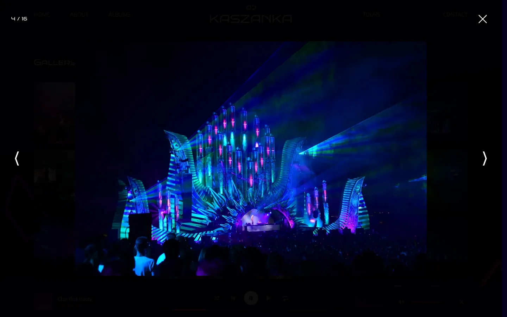
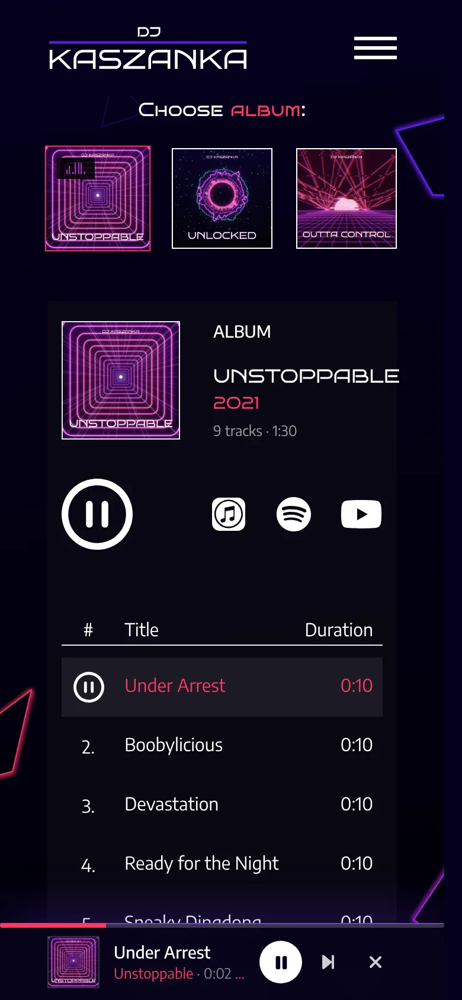

# DJ Kaszanka

Website for a fictional EDM artist, built as a front-end portfolio project.

**Live:** https://djkaszanka.netlify.app



## Highlights

### 🎧 Music player (Albums)
- Play any track, browse other albums while music keeps playing, and keep listening while you move between pages.
- Spotify-style player bar: play/pause, previous/next, **shuffle**, **repeat** (off / album / track), seek bar, volume and mute. Volume and modes are remembered between visits (`localStorage`).
- When an album ends, the next one starts automatically.
- **Live audio visualizer**: the bars react to the music that's actually playing. It uses the Web Audio API - an `AnalyserNode` splits the sound into frequencies (FFT) about 60 times a second, and the result is drawn on a `<canvas>`.
- Works with the keyboard (Space = play/pause) and with media keys / phone lock screen (Media Session API).
- *How it works:* one `<audio>` element for the whole site, shared through React Context. The UI follows the element's real `play`/`pause` events, so the buttons can never show the wrong state.



### 📅 Tour dates from a CMS (Tours)
- Events are managed in **Sanity** (a headless CMS) - adding or editing an event in the admin panel updates the site, no code changes needed.
- Data is fetched with GROQ queries and **TanStack Query**: month tabs are built from the data, events load 3 at a time ("Load more"), with loading skeletons, an error state with retry, and an empty state.
- **Events never run out:** a **Netlify Scheduled Function** runs every day and moves events whose date has passed to the end of the schedule, so the list keeps rolling.



### 🖼️ Gallery
- WebP images with tiny blurred placeholders and fixed proportions, so nothing jumps while loading; images below the screen are lazy-loaded and slide in as you scroll.
- Lightbox: arrows, keyboard (← → Esc), mouse wheel (one photo per gesture), touch swipe; neighbouring photos are preloaded; page scroll is locked and focus stays inside while it's open.

| Gallery | Lightbox |
| --- | --- |
|  |  |

### ✨ And also
- **About:** full-screen sections with scroll snapping, numbers that count up when they come into view, collaborators carousel.
- **Contact:** form validation with friendly messages and a simulated send (demo only - nothing is sent).
- **Page transitions** and animations with Motion; respects the system "reduce motion" setting.
- **Performance:** every page except Home is loaded only when you open it (code splitting), so the first visit downloads much less.
- **Accessibility:** real buttons and links, keyboard support, labels for screen readers.
- **Responsive** from small phones to wide monitors (content stays in a 1320px container).



## Tech stack

React 19 · Vite · React Router · Tailwind CSS 4 · Motion · TanStack Query · Sanity · Embla Carousel · Netlify (hosting + scheduled functions)

## Project structure

```
src/
  pages/        one component per page (lazy-loaded)
  components/   UI pieces (tracklist, lightbox, tour list, contact form…)
  player/       music player: provider, player bar, visualizer, equalizer
  lib/          Sanity client & queries, gallery data
studio/         Sanity Studio (CMS admin panel) + seed data
netlify/        scheduled function that rolls past events forward
scripts/        generators for the demo music, album covers and gallery images
```

## Running locally

```bash
npm install
npm run dev       # http://localhost:5173
npm run build     # production build
npm run lint
```

CMS admin panel (Sanity Studio):

```bash
cd studio
npm install
npm run dev
```

The daily event roll-over needs a `SANITY_WRITE_TOKEN` (Editor token) set in Netlify's environment variables.

## Assets

- The music clips and album covers are generated by code (`scripts/generate-audio.py`, `scripts/generate-covers.py`), so they're original and free to use.
- Gallery photos are free stock photos from Pixabay and Pexels.
- DJ Kaszanka is a fictional character.
